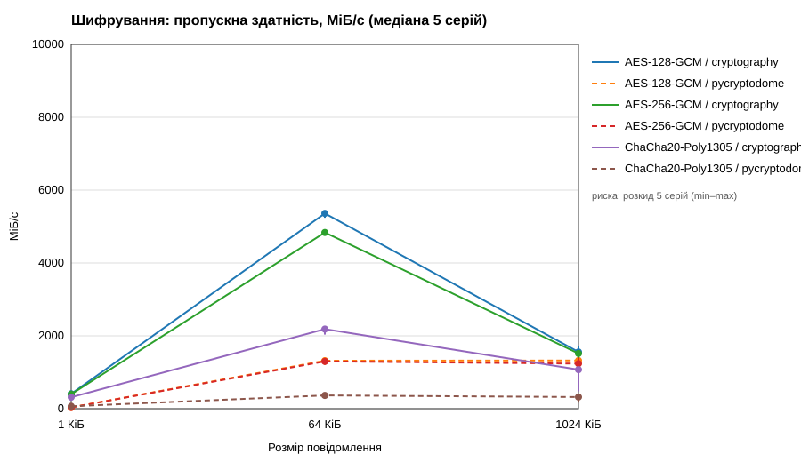
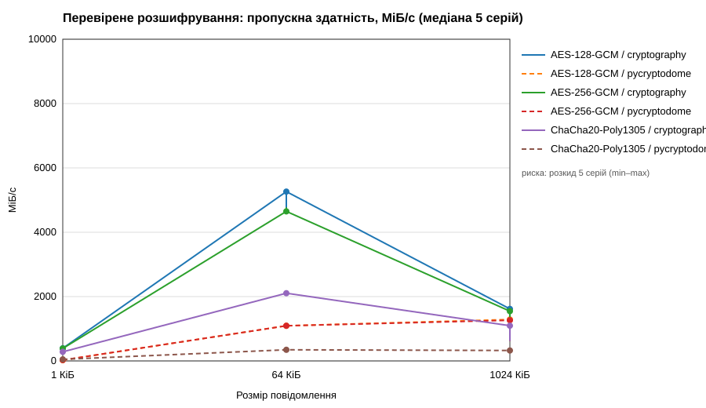

# Звіт практичної роботи 2 — симетричне шифрування даних в API «Цифровий деканат»

Виконав: Артамонов Данііл, група 233. Номер у списку — 1.

## 1. Мета

Додати до API практичної роботи 1 службові примітки студентів, які зберігаються лише в зашифрованому вигляді; реалізувати три симетричні профілі AEAD у двох бібліотеках через один контракт; перевірити відхилення підміни; виміряти продуктивність за однаковою методикою; зберегти роботу в Git.

## 2. Відомості про виконання

- Форк: https://github.com/artamonovdan-dev/digital-dean-api-starter
- Гілка: https://github.com/artamonovdan-dev/digital-dean-api-starter/tree/practice-02
- Теги: `practice-01`, `practice-02-base`, `practice-02`
- Індивідуальний варіант роботи 2: остача 1 mod 4 = **1 — категорія примітки**.
- Власні коміти після `practice-02-base` (`git log --no-merges --oneline refs/tags/practice-02-base..HEAD`):

```
(вставити вивід команди)
```

## 3. Зміни в наявному API

Нові операції (префікс `/api/v1`):

| Метод | Шлях | Успіх | Помилки |
|---|---|---|---|
| POST | /students/{student_id}/secure-notes | 201 | 404, 422, 503 |
| GET | /students/{student_id}/secure-notes/{note_id} | 200 | 404, 422, 500 |
| GET | /lab/crypto/benchmark-results | 200 | 404, 500 |

Шлях запису: перевірка студента → валідація `NoteCreate` (1–4096 байтів UTF-8, не лише пробіли, лише поля `text` і `category`) → новий `note_id` → резервування нового 12-байтового nonce зі спільного лічильника ключа → канонічні асоційовані дані → `seal_bytes` (AES-256-GCM, cryptography) → збереження конверта без `text` і ключа → відповідь 201 з метаданими.

Шлях читання зворотний: пошук запису з урахуванням власника → перевірка формату конверта (version, algorithm, backend, key_id, довжини nonce і tag, category) → відновлення очікуваного контексту зі шляху запиту → `open_bytes` з перевіркою тега → декодування UTF-8 → відповідь 200. Будь-яка невдача перевірки дає 500 `Protected note unavailable` без тексту.

Життєвий цикл ключа: під час запуску процесу створюється один ключ `secrets.token_bytes(32)`, `key_id` (UUID4) і один `NonceSequence`. Лічильник не скидається, зокрема під час очищення сховища; після межі 1 000 000 записів POST повертає 503, а старі примітки читаються. Перезапуск створює новий ключ і втрачає старі примітки.

Робота 1 збережена: моделі та маршрути студентів не змінені, усі регресійні тести проходять.

### Індивідуальний варіант 1 — категорія примітки

Поле `category` зі значеннями `general`, `academic`, `administrative` додано до запиту (`NoteCreate`, типово `general`), відповідей (`NoteMetadata`, `NoteRead`), внутрішнього конверта (`EncryptedNote.category`) і асоційованих даних (`note_aad(..., category)`). Невідома категорія дає 422; зміна збереженої категорії в конверті призводить до відхилення перевірки тега (500). Обидві операції використовують ту саму функцію формування контексту.

## 4. Фактичне середовище та методика

Середовище записане в `results/practice-02/report.json` → `environment` і продубльоване в `results/practice-02/summary.md` (процесор, ОС, архітектура, Python, cryptography і його OpenSSL, PyCryptodome, AES-NI/CLMUL за виявленням PyCryptodome, роздільність таймера, коміт перед дослідом).

Методика: розміри 1024, 65536 і 1048576 байтів; однакові випадкові байти й однаковий 64-байтовий контекст для всіх шести комбінацій; окремий випадковий ключ і власний `NonceSequence` для кожної комбінації (незалежні від ключа API); перевірка точного відновлення перед вимірюванням; прогрівання 10 операцій; 5 серій по 100 операцій; у таймер входять створення об'єкта бібліотеки, операція та обгортка адаптера; ключі, дані, nonce і конверти для розшифрування готуються до запуску таймера; порядок комбінацій перемішується між серіями (`random.Random(20261102)`); HTTP, файли, JSON і друк не входять до часу. Метрики: медіана п'яти середніх часів серій, IQR (`statistics.quantiles`, inclusive), пропускна здатність `S·10⁹ / (2²⁰·tₘ)` МіБ/с за байтами початкового повідомлення.

Команда повторного запуску:

```bash
python -m benchmarks.crypto_benchmark --output-dir results/practice-02
python -m benchmarks.plot_results --input results/practice-02/report.json
```

## 5. Результати вимірювань

- Сирі дані: `results/practice-02/raw.csv` (180 серій)
- Агрегати: `results/practice-02/report.json` (36 рядків)
- Таблиця медіан, IQR і МіБ/с: `results/practice-02/summary.md`





Точка — медіана п'яти серій, вертикальна риска — розкид серій (min–max).

Розмір результату для всіх комбінацій: шифротекст + тег = S + 16 байтів; nonce (12 байтів) і метадані зберігаються окремо.

Аналіз (заповнити за власними числами): (1) яка комбінація найшвидша для 1 МіБ і наскільки; (2) як змінюється швидкість від 1 КіБ до 1 МіБ (для малих повідомлень домінують накладні витрати створення об'єкта); (3) різниця між AES-128 і AES-256; (4) різниця між бібліотеками; (5) чи є AES-NI.

## 6. Перевірки захисту та API

`python -m pytest` — (вставити підсумок, напр. «N passed»).

| № | Сценарій | Де перевірено |
|---|---|---|
| 1 | Точне відновлення (порожні, короткі, UTF-8, 1/64/1024 КіБ) для 6 комбінацій | `test_crypto.py::test_round_trip*` |
| 2–6 | Зміна шифротексту, тега, AAD, неправильний ключ, інший nonce; усічений тег; неправильна довжина ключа | `test_tampering_is_rejected`, `test_truncated_tag_is_rejected`, `test_wrong_key_length_*` |
| 7 | Сумісність бібліотек, 3 алгоритми × 2 напрями | `test_cross_library` |
| 8 | Лічильник: потоковий тест, межа, 503 і читання старої примітки | `test_counter_limit_and_concurrency`, `test_nonce_limit_rejects_only_new_writes` |
| 9–10 | Створення і читання; внутрішній запис без text/key, nonce 12, tag 16 | `test_note_api_and_internal_storage` |
| 11 | Копія конверта під іншим студентом відхиляється | `test_copied_envelope_under_other_context_is_rejected` |
| 12 | Пошкоджений конверт → 500 без тексту | `test_damaged_note_is_rejected_without_plaintext`, `test_invalid_envelope_format_is_500` |
| 13 | 4096 байтів прийнято; 4097, пробіли, `key` → 422 | `test_api_accepts_byte_limit`, `test_api_rejects_invalid_input` |
| 14 | Звіт: 200 / 404 / 500 | `test_benchmark_report_*` |
| 15 | Регресія роботи 1 і варіант 1 (категорія) | `test_students.py`, `test_category_*`, `test_changed_stored_category_fails_verification` |

Postman: `postman/digital-dean-practice-02.postman_collection.json` (15 запитів, включно з варіантом 1) — (вставити результат Run collection).

## 7. Висновки і межі

Обраний для API профіль AES-256-GCM (cryptography) забезпечує конфіденційність тексту примітки та цілісність і автентичність тексту разом із контекстом (студент, примітка, алгоритм, ключ, категорія). Тести підтверджують, що будь-яка зміна шифротексту, тега, контексту, ключа чи nonce відхиляється без видачі відкритого тексту. (Додати: за вимірюваннями швидкість профілю в моєму середовищі становить … МіБ/с, що достатньо для приміток до 4 КіБ.)

Найшвидший результат у цьому середовищі не означає «найбезпечніший» чи «найкращий для всіх систем»; успішні тести не доводять повної криптографічної стійкості. Обмеження: тимчасове однопроцесне сховище в пам'яті, ключ втрачається після перезапуску, немає автентифікації користувача, авторизації та HTTPS, немає контролю повторної видачі старого конверта.
