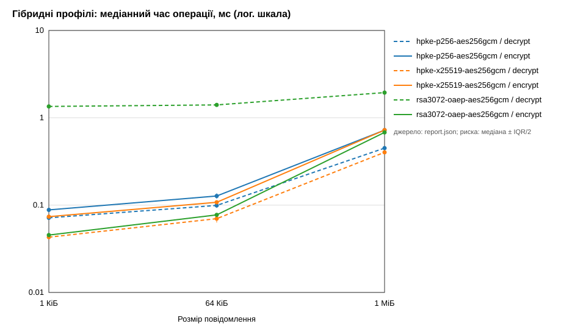
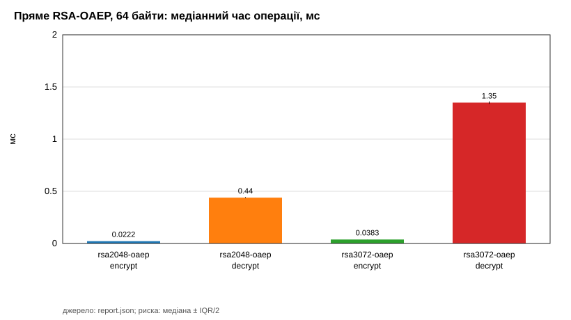
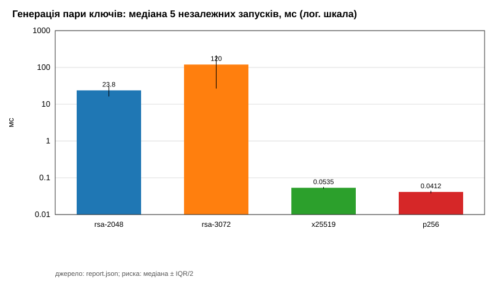

# Звіт з практичної роботи 3 — асиметричне та гібридне шифрування

## Титульні відомості

- Студент: Артамонов Данііл, група 233, номер у списку 1.
- Варіант: остача 1 mod 4 = **1 — необов'язковий параметр `payload_bytes`**.
- Дата: (вставити)
- Форк: https://github.com/artamonovdan-dev/digital-dean-api-starter
- Гілка: `practice-03`; тег: `practice-03`; SHA фінальної фіксації: (вставити `git rev-parse HEAD`).

## Мета та продовження API

Мета — реалізувати бібліотечні профілі RSA-OAEP, навчального гібриду RSA+AES-GCM і HPKE, виміряти генерацію ключів, шифрування й розшифрування, перевірити коректність і безпечну відмову та додати до того самого API новий метод читання результатів.

Робота продовжує тег `practice-02`: гілку `practice-03` створено від нього, злито `upstream/practice-03-starter`, створено анотований baseline `practice-03-base`. Тести практичних 1 і 2 проходили до імпорту та проходять після реалізації. Перевірка спільної історії: `git merge-base --is-ancestor practice-02 HEAD` (код 0).

Змінені модулі: `app/security/asymmetric/adapters.py` (5 профілів), `app/schemas/asymmetric_report.py` (семантичний валідатор), `benchmarks/asymmetric_benchmark.py` (експеримент), `benchmarks/plot_asymmetric.py` (графіки), `app/api/asymmetric_lab.py` (новий GET і варіант), `app/main.py` (підключення, версія 0.3.0), тести, Postman, README.

## Середовище та методика

Фактичні значення — з `results/practice-03/report.json` → `environment` та `results/practice-03/summary.md`: Python (вставити), cryptography 48.0.1, OpenSSL саме цієї бібліотеки (вставити), ОС (вставити), CPU (вставити). SHA коду перед експериментом — `experiment.source_commit`.

Методика: синтетичні повідомлення 64 байти (прямий RSA) і 1024/65536/1048576 байтів (гібриди); прогрів 10 операцій; 5 серій по 20 операцій; 5 незалежних генерацій кожного типу ключа (прогрівальна пара не враховується). Перед кожною серією порядок профілів циклічно зсувається (записано в `series_order.json`). Ключі одержувача, повідомлення і конверти для decrypt готуються до таймера; у таймері encrypt гібриду — новий ключ AES, nonce, OAEP і AES-GCM, у HPKE — увесь `Suite.encrypt`; у таймері decrypt — лише 20 викликів, перевірка відновлених байтів після зупинки таймера. DER-розмір відкритого ключа, CSV/JSON і запис файлів — поза таймером.

Формули: t_r = Δt_r / 20; median_ns — медіана п'яти t_r; IQR = Q3 − Q1 (`statistics.quantiles`, `method="inclusive"`); пропускна здатність гібридів v = S·10⁹ / (2²⁰·t_m) МіБ/с, для прямого RSA — null.

## Коректність і параметри

Межа OAEP: m_max = k − 2·hLen − 2 = 190 байтів (RSA-2048) і 318 байтів (RSA-3072); m_max шифрується, m_max + 1 відхиляється.

Контекст `b"digital-dean:practice-03:report-v1"` діє по-різному: у прямому RSA — OAEP label; у гібриді — OAEP label для ключа AES і окремо AAD для AES-GCM; у HPKE — info, що входить до виведення ключів. Base mode HPKE (як і RSA-профілі) не автентифікує відправника: зашифрувати повідомлення може кожен, хто має відкритий ключ.

Ключовий фрагмент гібриду (`adapters.py`):

```python
key = AESGCM.generate_key(bit_length=256)
nonce = secrets.token_bytes(NONCE_BYTES)
wrapped = public.encrypt(key, _oaep(context))
return wrapped + nonce + AESGCM(key).encrypt(nonce, message, context)
```

22 перевірки (roundtrip, wrong_key, tamper, wrong_context для 5 профілів + oaep_boundary для 2 RSA) виконуються реальними операціями і записуються в `checks`; невдача зберігалась би як `passed=false`. Результат: (вставити «22 з 22 пройдено» з summary.md).

## Результати

- `results/practice-03/raw.csv` — 130 рядків (20 генерацій + 110 серій).
- `results/practice-03/report.json` — 4 + 22 агрегати і 22 перевірки.
- `results/practice-03/summary.md` — таблиці медіан, IQR, розмірів конверта, МіБ/с.







Аналіз (заповнити своїми числами, порівнюючи лише однакові розміри й операції): (1) прямий RSA-2048 проти RSA-3072 на 64 байтах — у скільки разів повільніше розшифрування 3072; (2) гібриди на 1 КіБ — переважають накладні витрати асиметричної частини; на 1 МіБ — різниця між профілями зменшується, бо домінує AES-GCM; (3) генерація RSA-3072 значно довша й має великий розкид, X25519/P-256 — частки мілісекунди; (4) накладні витрати конверта: 412 / 48 / 81 байт.

## API та індивідуальний варіант

`GET /api/v1/lab/crypto/asymmetric-benchmark-results` з `response_model=BenchmarkResponse`: 200 / 404 / 500 (безпечні `detail` без шляхів і стека). Маршрут не імпортує й не викликає `run_experiment` і не приймає шлях файлу.

Варіант 1: необов'язковий `payload_bytes: int` з явною перевіркою переліку 64/1024/65536/1048576 (інакше 422). Спочатку повний файл проходить `BenchmarkReport` і семантичний валідатор, потім фільтрується лише `results`; `key_generation` (4) і `checks` (22) залишаються повними. `payload_bytes=64` → 4 результати; 1024 → 6; 65 або `abc` → 422.

Приклад відповіді (вставити фрагмент `GET ...?payload_bytes=1024` з власного звіту).

## Перевірки

`python -m pytest` — (вставити підсумок). Покрито: усі довжини таблиці 2, 22 перевірки, невідомий профіль, невідповідний ключ, обрізаний конверт, свіжий матеріал; схема (дубль/пропуск, зайве поле, неправильний тип, NaN/Infinity, від'ємний і нульовий час, формула, довжина конверта, UTC, SHA); читання файлу (404, 500, завеликий, дублікати JSON); API (реєстрація, response_model, без запуску експерименту, без шляху, без секретів); варіант 1; регресії практичних 1 і 2.

Postman: `postman/digital-dean-practice-03.postman_collection.json`, `variant=1` — (вставити результат Run). Кроки 404/500 — вручну з тимчасово прибраним/зіпсованим локальним файлом, після чого файл відновлено.

## Git

```
(вставити git remote -v)
(вставити git log --oneline practice-03-base..HEAD)
```

## Висновки та межі

Усі п'ять профілів коректно відновлюють дані й відхиляють змінений конверт, інший ключ і інший контекст. Прямий RSA-OAEP придатний лише для коротких повідомлень (до 190/318 байтів); для більших даних потрібна гібридна схема. Швидкість і довжина ключа не визначають «найкращий» чи «сильніший» алгоритм: різниці, співмірні з IQR, не обґрунтовують категоричних висновків. Експеримент не вимірює криптографічну стійкість і сторонні канали; Base mode не автентифікує відправника; API локальне, без автентифікації користувача і HTTPS.

## Використані джерела

RFC 8017 (PKCS #1 v2.2, RSA-OAEP); RFC 9180 (HPKE); NIST SP 800-38D (GCM); документація cryptography 48 (RSA, AESGCM, HPKE); документація Python `time.perf_counter_ns`, `statistics`, `secrets`; документація FastAPI і Pydantic. Дата звернення: (вставити).

## Алфавітний глосарій

- **AAD** (Additional Authenticated Data) — додаткові автентифіковані дані, перевіряються, але не шифруються.
- **AEAD** (Authenticated Encryption with Associated Data) — автентифіковане шифрування з асоційованими даними.
- **AES-GCM** (Advanced Encryption Standard, Galois/Counter Mode) — симетричне AEAD-шифрування.
- **DER / SPKI** (Distinguished Encoding Rules / SubjectPublicKeyInfo) — двійковий формат відкритого ключа.
- **HKDF** (HMAC-based Key Derivation Function) — функція виведення ключів.
- **HPKE** (Hybrid Public Key Encryption) — стандартизоване гібридне шифрування з відкритим ключем.
- **IQR** (Interquartile Range) — міжквартильний розмах.
- **KEM** (Key Encapsulation Mechanism) — механізм інкапсуляції ключа.
- **MGF1** (Mask Generation Function 1) — функція генерації маски в OAEP.
- **OAEP** (Optimal Asymmetric Encryption Padding) — схема доповнення для шифрування RSA.
- **P-256 / X25519** — еліптичні криві для узгодження ключів у KEM.
- **RSA** (Rivest–Shamir–Adleman) — асиметрична криптосистема.
